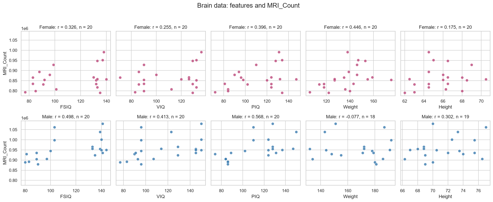
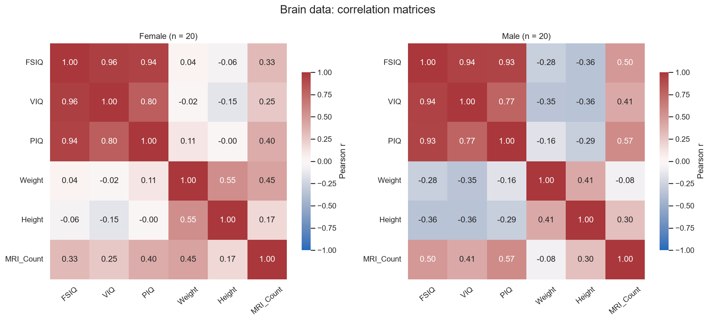

# Лабораторная работа №2. Pandas и корреляционный анализ

## 1. Titanic

Данные загружены из `titanic.csv` функцией `pd.read_csv`. Пропуски посчитаны через `isna().sum()`, показатели по классам — через `groupby`. Неизвестный возраст не заменяется нулём.

Число пассажиров: **891**. Число пассажиров строго старше 30 лет: **305**.

| Столбец | Количество пропусков |
| --- | ---: |
| PassengerId | 0 |
| Survived | 0 |
| Pclass | 0 |
| Name | 0 |
| Sex | 0 |
| Age | 177 |
| SibSp | 0 |
| Parch | 0 |
| Ticket | 0 |
| Fare | 0 |
| Cabin | 687 |
| Embarked | 2 |

| Pclass | Средний возраст, лет | Доля выживших |
| --- | ---: | ---: |
| 1 | 38.233 | 0.629630 (62.96%) |
| 2 | 29.878 | 0.472826 (47.28%) |
| 3 | 25.141 | 0.242363 (24.24%) |

Пять наибольших значений Fare по убыванию: 512.3292, 512.3292, 512.3292, 263.0000, 263.0000.
Повторяющиеся тарифы сохранены: нужны пять значений, а не пять уникальных тарифов.

В этой выборке средний возраст и доля выживших выше в первом классе. Большинство пропусков приходится на Cabin; пропуски Age исключены только из расчёта возраста, а не из всей таблицы.

## 2. Корреляционный анализ

Файл `brainsize.txt` прочитан с разделителем tab. Обозначения `NA` распознаны как пропуски. Анализ проведён отдельно для Female и Male.

Женщин: **20**, мужчин: **20**.

Использован коэффициент Пирсона: `r = sum((x-x_mean)*(y-y_mean)) / sqrt(sum((x-x_mean)**2)*sum((y-y_mean)**2))`.
Он показывает направление и силу линейной связи. При расчёте каждого коэффициента исключаются только строки, где отсутствует один из двух участвующих показателей.

| Признак | r, женщины | Число пар | r, мужчины | Число пар |
| --- | ---: | ---: | ---: | ---: |
| FSIQ | 0.325697 | 20 | 0.498369 | 20 |
| VIQ | 0.254933 | 20 | 0.413105 | 20 |
| PIQ | 0.396157 | 20 | 0.568237 | 20 |
| Weight | 0.446271 | 20 | -0.076875 | 18 |
| Height | 0.174541 | 20 | 0.301543 | 19 |

Наибольший модуль корреляции с MRI_Count: **PIQ**, группа — **мужчины**, `r = 0.568237`. Функция возвращает `strongest_mri_feature = "PIQ"`.

У мужчин самая выраженная положительная линейная связь MRI_Count — с PIQ; у женщин — с Weight. Связь MRI_Count с Weight у мужчин близка к нулю и слегка отрицательна. Коэффициенты описывают эту небольшую выборку; корреляция сама по себе не доказывает причинную связь. Статистическая значимость различий между группами здесь не проверялась.

### Диаграммы рассеяния



Верхняя строка — женщины, нижняя — мужчины. Подписи содержат коэффициент r и число полных пар n. По горизонтали — выбранный признак, по вертикали — MRI_Count.

### Матрицы корреляций



У обеих матриц одинаковая цветовая шкала от -1 до 1. Диагональные значения равны 1, поскольку признак сравнивается с самим собой; сам MRI_Count не участвует в выборе strongest_mri_feature.

## 3. Запуск и проверка

Из папки проекта:

```bash
python -m pip install -r requirements.txt
python -m unittest discover -s tests -v
python run_analysis.py
```

Тесты находятся в `tests/`. Они проверяют агрегаты на небольших таблицах и на приложенных данных, границу возраста 30 лет, пропуски, повторяющиеся тарифы, пустые таблицы, постоянные признаки и выбор максимума по модулю из обеих групп. Корреляции небольших таблиц сверяются с независимым расчётом по формуле Пирсона.

Для неопределённой корреляции возвращается NaN. Если все коэффициенты неопределены, strongest_mri_feature — пустая строка. Таблица без строк, но с заголовками поддерживается. Отсутствие файла или обязательных столбцов вызывает ошибку.
